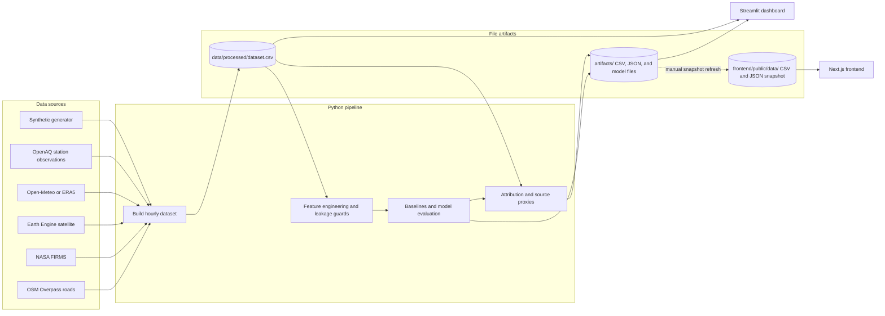

# Kolkata PM2.5

**Estimate and explore hourly PM2.5 at Kolkata monitoring stations, with forecast uncertainty and transparent model analysis.**

This project combines an offline-capable Python research pipeline with two dashboards: a Streamlit app that reads generated artifacts, and a Next.js frontend that reads a checked-in snapshot of those artifacts. It helps researchers and project reviewers inspect the predictions, their limitations, and seasonal source-proxy patterns. The default demo uses synthetic data, so it demonstrates the workflow without making claims about real Kolkata air quality.


> **Research caveat:** Demo metrics come from a deterministic synthetic dataset. Live-data results depend on station coverage and data quality. Source labels are rule-based proxies; agreement with model importance is not causal proof. Station coordinates are approximate and must be verified before publication.

## Contents

- [Overview](#overview)
- [Features](#features)
- [Screenshots and demo](#screenshots-and-demo)
- [Technology](#technology)
- [Architecture and data flow](#architecture-and-data-flow)
- [Project structure](#project-structure)
- [Installation](#installation)
- [Configuration](#configuration-and-environment-variables)
- [Usage](#usage)
- [Data and artifacts](#data-and-artifacts)
- [API and database](#api-and-database)
- [Security and privacy](#security-and-privacy)
- [Testing](#testing)
- [Deployment](#deployment)
- [Limitations and next steps](#limitations-and-next-steps)
- [Hackathon framing](#hackathon-framing)
- [Contributing](#contributing)
- [License, credits, and contact](#license-credits-and-contact)

## Overview

Ground monitors measure PM2.5 at fixed locations, while satellite aerosol optical depth
(AOD) measures a column through the atmosphere and is often unavailable under cloud.
This project explores how station history, weather, satellite context, fire detections,
and time features can be combined to estimate near-term surface PM2.5.

The Python pipeline assembles hourly station data, engineers leakage-aware features,
compares forecasting models, and produces uncertainty and attribution artifacts. The
dashboards make these outputs easier to inspect. Intended users include air-quality
researchers, students, and hackathon reviewers evaluating a reproducible analysis
workflow.

Satellite products are daily or overpass-based. They are broadcast as context across
hours; hourly variation comes from meteorology, time features, and lagged station readings.
The README and methodology therefore describe the output as hourly estimation/forecasting,
not hourly satellite observation.

## Features

### Implemented in the Python pipeline

- **Synthetic demo mode:** deterministic dataset generation with no credentials or network
  access, suitable for exercising the pipeline.
- **Optional live data assembly:** adapters for OpenAQ station observations, Open-Meteo or
  ERA5 weather, Google Earth Engine satellite data, NASA FIRMS fire detections, and
  OpenStreetMap road proximity via Overpass.
- **Leakage-aware feature engineering:** cyclical time and wind direction, weather and
  ventilation terms, station-grouped PM2.5 lags and rolling statistics, AOD missingness,
  and horizon-specific satellite safeguards. Same-station co-pollutants are excluded from
  the prediction feature matrix.
- **Forecast comparison:** persistence and climatology baselines, Ridge, and quantile
  gradient boosting. Default horizons are 1, 6, and 24 hours; optional LSTM sequence
  training is available with PyTorch.
- **Evaluation:** chronological test-year split, optional leave-one-station-out (LOSO),
  regression metrics, high-PM episode metrics, prediction-interval coverage, and AOD
  missingness analysis.
- **Interpretation and source proxies:** SHAP when installed, with permutation-based
  fallback; seasonal importance; heuristic biomass, dust, traffic, secondary, and
  background proxy labels; and a proxy/model-driver consistency table.

### Implemented dashboards

- **Streamlit:** overview, model performance, explainability, source proxies, robustness,
  and methodology views. Reads pipeline outputs from `data/processed/` and `artifacts/`.
- **Next.js frontend:** overview/map, forecasts and benchmarks, attribution, source
  proxies, robustness, and a scenario simulator. Most views consume CSV/JSON files from
  `frontend/public/data/` and can display the checked-in artifact snapshot.
- **Scenario simulator caveat:** the frontend's “What-If” panel calculates a
  physics-inspired heuristic in the browser. It does not call the fitted GBDT and is not
  a validated prediction.

## Screenshots and demo

No screenshots, hosted live demo, or demonstration video are included or configured in
this repository. Run either dashboard locally using the instructions below to preview
the project. Add verified screenshots or demo links here when they are available.

## Technology

| Area | Technologies found in the repository |
|---|---|
| Python pipeline | Python 3.10+, pandas, NumPy, scikit-learn, PyYAML, joblib |
| Python dashboard | Streamlit, Plotly |
| Web frontend | Next.js 15, React 19, TypeScript 5.7, Tailwind CSS |
| Frontend charts and UI | Apache ECharts, Radix UI, Lucide, Zustand, TanStack Query |
| Spatial visualization | Projected SVG station map and GeoJSON station asset |
| In-browser query infrastructure | DuckDB-Wasm module is present; current dashboard data loading uses CSV/JSON fetches |
| External data sources | OpenAQ v3, Open-Meteo Archive, Copernicus CDS/ERA5, Google Earth Engine, NASA FIRMS, OpenStreetMap Overpass |
| Build and tests | setuptools, npm, pytest, TypeScript |
| Database / hosting | No server database or hosting platform is configured |

LightGBM, SHAP, PyTorch, Earth Engine, CDS API, and optional geospatial packages are not
installed by the core requirements. The Python pipeline uses its documented fallbacks
where available.

## Architecture and data flow

There is no application backend that serves a REST API. The Python CLI is the data and
model pipeline; the dashboards read files from disk or static public assets.



### Data flow details

1. `build` creates a deterministic synthetic dataset or combines live observations with
   available weather and optional satellite, fire, and road features.
2. `features.py` creates station-aware historical features and future targets for the
   configured forecast horizon. Satellite features are removed when they would refer to
   information unavailable at the forecast time.
3. `train` evaluates baselines and configured models on a time-based split, and can also
   run LOSO validation. It writes metrics and predictions to `artifacts/`.
4. `explain` computes attribution and heuristic proxy summaries from the dataset and
   model outputs.
5. The Streamlit dashboard reads local pipeline outputs. The Next.js frontend fetches
   static files from `frontend/public/data/`; regenerating backend artifacts does not
   update this snapshot automatically.

## Project structure

```text
kolkata-pm25/
├── config.example.yaml          # Default project and provider settings
├── .env.example                 # Optional provider credential names
├── requirements.txt             # Core Python and test dependencies
├── pyproject.toml               # Python packaging and pytest configuration
├── Makefile                     # Python and frontend convenience targets
├── src/pm25/
│   ├── cli.py                   # build, train, explain, all, and app commands
│   ├── config.py                # Built-in defaults, YAML, and .env loading
│   ├── features.py              # Feature engineering and leakage guards
│   ├── stations.py              # Station registry and approximate coordinates
│   ├── data/                    # Source adapters and synthetic data generator
│   ├── models/                  # Baselines, GBDT, optional sequence model, evaluation
│   ├── explain/                 # Feature importance, attribution, and proxies
│   └── app/dashboard.py         # Streamlit dashboard
├── frontend/
│   ├── src/app/                 # Next.js app entry point and layout
│   ├── src/components/          # Views, charts, map, and UI components
│   ├── src/lib/                 # Static data loaders, queries, state, types
│   └── public/                  # GeoJSON and checked-in data snapshot
├── docs/                        # Methodology, data dictionary, report outline
└── tests/                       # Python unit tests and dashboard smoke test
```

Generated `data/raw/`, `data/processed/`, and `artifacts/` directories are git-ignored.
Their files are created when you run the pipeline. The frontend's `public/data/` snapshot
is checked in separately.

## Installation

### Prerequisites

- Python 3.10 or newer.
- Node.js and npm compatible with the versions required by the lockfile (the exact
  supported Node.js range is not declared in `package.json`).
- Git, if cloning the project.

### Python pipeline and Streamlit app

From the repository root:

```bash
git clone <repository-url>
cd kolkata-pm25
python -m venv .venv
```

Activate the environment, then install the dependencies and project in editable mode:

```powershell
# Windows PowerShell
.venv\Scripts\Activate.ps1
python -m pip install -r requirements.txt
python -m pip install -e .
```

```bash
# macOS / Linux
source .venv/bin/activate
python -m pip install -r requirements.txt
python -m pip install -e .
```

The editable install exposes the `pm25` package to the CLI. Alternatively, Makefile
targets set `PYTHONPATH=src` (use Make from Git Bash, WSL, or a Unix shell).

### Next.js frontend

In a second terminal, from the repository root:

```bash
cd frontend
npm ci
npm run dev
```

Open [http://localhost:3000](http://localhost:3000). The frontend reads the files already
checked into `frontend/public/data/`; it does not need the Python pipeline running to
render that snapshot.

## Configuration and environment variables

The CLI has built-in defaults; `config.yaml` is optional. To customize the defaults,
copy the example config and edit it:

```bash
cp config.example.yaml config.yaml
cp .env.example .env
```

On PowerShell use `Copy-Item config.example.yaml config.yaml` and
`Copy-Item .env.example .env`. Both local files are ignored by Git. The demo mode needs
no environment variables.

| Variable / credential | Purpose | Required? | Notes |
|---|---|---:|---|
| `OPENAQ_API_KEY` | OpenAQ v3 station measurements | For live ground observations | Read by the OpenAQ adapter. |
| `GEE_PROJECT` | Google Earth Engine project | Only when Earth Engine satellite data is enabled | Earth Engine authentication must also be configured. |
| `FIRMS_MAP_KEY` | NASA FIRMS fire detections | Optional | Without it, fire features are set to zero. |
| `CDSAPI_KEY` | Listed in `.env.example` for CDS/ERA5 | Not read directly by this code | Configure CDS credentials using the `cdsapi`-supported `~/.cdsapirc` file as described in the example comments. |
| `PM25_ROOT` | Root directory used by the Streamlit dashboard to locate `data/processed/` and `artifacts/` | Optional | Defaults to the repository root inferred from the dashboard file. |

The Open-Meteo weather provider is the default and needs no API key. Optional provider
selection and date/station settings live in `config.yaml`; inspect
[config.example.yaml](config.example.yaml) for the available settings. Never commit real
credentials.

## Usage

### Run the complete demo pipeline

```bash
python -m pm25.cli all
```

This runs demo dataset generation, model training/evaluation, and attribution in sequence.
To run one step at a time:

```bash
python -m pm25.cli build --mode demo
python -m pm25.cli train
python -m pm25.cli explain
python -m pm25.cli app
```

The Streamlit app opens at `http://localhost:8501`. It reads generated files; run the
pipeline first to populate them. Use the sidebar to filter stations and date range, then
inspect the Overview, Model, Explainability, Sources, Robustness, and Method tabs.

Useful CLI options:

```bash
python -m pm25.cli --help
python -m pm25.cli build --mode live --start 2025-03-01 --end 2026-10-31
python -m pm25.cli train --horizons 1,6,24 --test-year 2026
python -m pm25.cli train --quick                 # smaller/faster run, skips LOSO
python -m pm25.cli train --deep                  # include optional sequence model
python -m pm25.cli train --no-loso               # skip leave-one-station-out evaluation
python -m pm25.cli app --port 8502
```

Options can also take `--config path` and `--root path`. Run `python -m pm25.cli <command>
--help` for command-specific options.

### Run the frontend

After `npm ci` in `frontend/`, `npm run dev` starts the local development server. The
navigation offers six panels: Overview & Map, Forecasting & Benchmarks, Causal
Attribution, Source Proxies, Robustness & Satellite, and What-If Simulator. Use the
station and horizon controls where shown. The simulator exposes sliders for atmospheric
and transport assumptions and explicitly labels its output as heuristic.

### Run with live data

Set the relevant credentials, edit the providers and date window in `config.yaml`, then
run:

```bash
python -m pm25.cli build --mode live
python -m pm25.cli train
python -m pm25.cli explain
```

The checked-in default live window is 2025-03-01 through 2026-10-31 with a 2026 test
year. Coverage is station- and sensor-dependent; inspect logs and resulting data before
interpreting scores. Optional data providers can fail or be skipped when unavailable.

## Data and artifacts

The build output is a station-hour table. See the [data dictionary](docs/data_dictionary.md)
for the available fields and units.

| Output | Contents |
|---|---|
| `data/processed/dataset.csv` | Assembled station-hour observations and source features |
| `artifacts/metrics.json` | Model metrics by forecast horizon, with LOSO information when run |
| `artifacts/predictions.csv` | Held-out predictions and diagnostics |
| `artifacts/models/` | Serialized trained estimators |
| `artifacts/importance*.csv` | Feature-importance outputs |
| `artifacts/seasonal_importance.csv` | Seasonal importance summaries |
| `artifacts/proxy_*.csv` | Proxy prevalence, concentration, and agreement outputs |
| `artifacts/attribution_summary.json` | Summary of model drivers and attribution caveats |
| `frontend/public/data/` | Separate static copy consumed by the Next.js frontend |

For +24 h prediction, same-day AOD is not used as a future feature. PM2.5 lags and rolling
features are grouped by station and shifted to prevent using future values. These design
choices are described in [docs/methodology.md](docs/methodology.md).

## API and database

There is no application REST/GraphQL API, user account system, or database schema in this
repository. The pipeline exchanges data through CSV and JSON files. The browser frontend
fetches static files under `/data/`; DuckDB-Wasm query helpers exist in the source, but
the current views load CSV/JSON directly and no Parquet export command is implemented.

The project connects to third-party data services only when their live adapters are used:
OpenAQ v3, Open-Meteo Archive, CDS/ERA5 (optional), Earth Engine (optional), NASA FIRMS
(optional), and OpenStreetMap Overpass (optional). There are no project-owned API
endpoints to document.

## Security and privacy

- API credentials are read from local environment/configuration and should stay in ignored
  `.env`/`config.yaml` files or provider-specific credential files. `.env.example`
  contains blank values only.
- The Next.js config adds browser security headers, including a Content Security Policy,
  `X-Content-Type-Options`, `X-Frame-Options`, and `Referrer-Policy`.
- No authentication, authorization, user profile, or personal-data workflow is
  implemented. The application primarily handles air-quality observations and generated
  model artifacts.
- Review provider terms and data licensing before redistributing live-source data.

## Testing

The Python suite uses pytest. Tests cover utility behavior, OpenAQ handling, feature
leakage safeguards, model evaluation/GBDT behavior, fire features, source proxies, and a
Streamlit dashboard smoke check.

```bash
python -m pytest tests -q
```

Or run the Make target from a compatible shell:

```bash
make test
```

`make test` runs pytest and `tests/smoke_dashboard.py`. No dedicated frontend test or
lint script is configured. The frontend package does define `npm run build` for a
production build.

## Deployment

No deployment platform, public URL, container setup, or CI release workflow is configured
in this repository. For a production build of the frontend:

```bash
cd frontend
npm ci
npm run build
npm start
```

The runtime must serve the Next.js application and the files in `public/`. Before
publishing, update the static data snapshot intentionally, validate data provenance, and
configure hosting for the application's security headers. The Streamlit dashboard can be
launched with `python -m pm25.cli app`; hosting and secrets management for a public
deployment are not specified here.

## Limitations and next steps

### Current limitations

- Demo output is synthetic and must not be presented as measured Kolkata results.
- Approximate station coordinates and station metadata need verification.
- OpenAQ coverage is uneven; retired/replacement sensors and gaps affect the usable period.
- Daily satellite retrievals do not provide hourly observations; cloud cover causes
  informative AOD gaps.
- Open-Meteo does not provide the boundary-layer-height feature; the ERA5 option requires
  extra setup.
- Source proxies are heuristic labels. They are not PMF, speciation analysis, or proof of
  causal source contributions.
- The frontend reads a static artifact snapshot that is not refreshed automatically.
- The interactive frontend simulator is an illustrative formula, not the fitted model.
- The Next.js map uses a simplified projected SVG and approximate station coordinates;
  it is not a validated GIS product.

### Useful future work

- Verify station locations, monitor identities, and live coverage against authoritative
  records.
- Add a reproducible export/sync step from pipeline artifacts to frontend assets.
- Connect the simulator to a versioned model inference interface or keep it clearly
  separated as a teaching aid.
- Add frontend tests and a documented deployment workflow.
- Evaluate with additional time periods and stations, and improve calibration and
  spatial generalization with better meteorological coverage.
- Add verified screenshots, live demo, team, and project contact details.

## Hackathon framing

| Item | Project framing |
|---|---|
| Problem | Hourly surface PM2.5 estimation is difficult when ground monitors are sparse and satellite retrievals are intermittent and measure atmospheric columns. |
| Proposed solution | Combine station history, meteorology, satellite context, fire transport, and temporal features; evaluate forecast horizons and expose uncertainty and interpretation outputs. |
| Distinctive angle | Leakage safeguards, multiple baselines, time and station holdouts, uncertainty coverage, and an explicit comparison between model drivers and independently defined heuristic proxies. |
| Intended audience | Air-quality researchers, students, and analysts exploring monitoring and forecasting methods. |
| Practical impact | A reproducible prototype for examining where the data and modeling approach work or fail; it is not an operational public-health alert service. |
| Scalability | More stations, validated inputs, stronger calibration, and an automated artifact pipeline could extend the prototype. |

No hackathon name, track, team, sponsor, award, or impact result is specified in the
repository.

## Contributing

Contributions are welcome. No project-specific contribution policy or code of conduct is
currently present. A typical contribution workflow is:

1. Fork the repository and create a focused branch.
2. Install the Python dependencies and, for frontend changes, run `npm ci` in
   `frontend/`.
3. Make the change and add or update tests when behavior changes.
4. Run `python -m pytest tests -q`; for frontend changes, run `npm run build` from
   `frontend/`.
5. Open a pull request describing the change, validation performed, data assumptions, and
   any effect on generated artifacts.

Report bugs through the repository's issue tracker once its public repository URL is
configured. Do not include API keys or private data in issues.

## License, credits, and contact

No license file or license declaration is present. Unless a license is added, the
project's reuse and redistribution terms are **not specified**. Add a license before
inviting external reuse.

The project integrates third-party services and data providers listed above. Consult
their own terms and attribution requirements when using live data. No team-member names,
maintainer contact, public repository URL, or hosted demo URL are documented in the
project files.

### Further documentation

- [Methodology](docs/methodology.md)
- [Data dictionary](docs/data_dictionary.md)
- [Report outline](docs/report_outline.md)
- [Frontend README](frontend/README.md)
